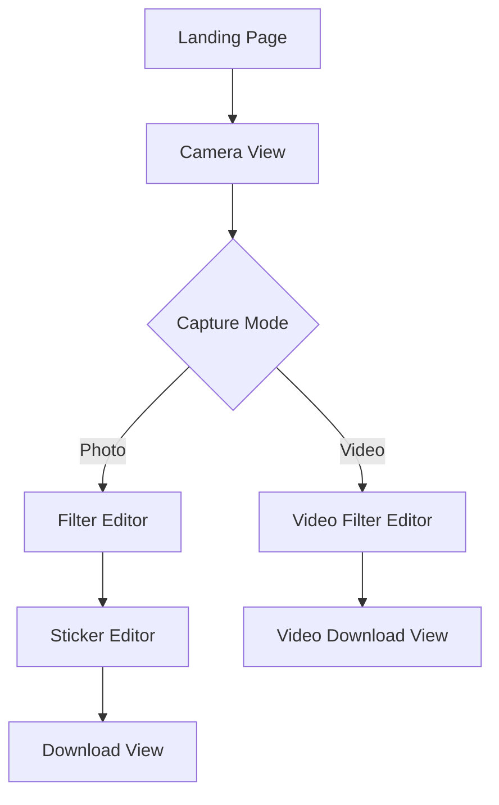

# Architecture Documentation

## System Overview

Snap Style Booth is a web-based photo booth application built with modern web technologies. The application provides a complete photo and video capture experience with filters, stickers, templates, and export capabilities.

## Technology Stack

### Frontend Framework
- **React 18.3.1** - Main UI framework with hooks
- **TypeScript 5.8.3** - Type safety and developer experience
- **Vite 5.4.19** - Build tool and development server

### UI/UX Components
- **shadcn/ui** - Component library built on Radix UI primitives
- **Tailwind CSS 3.4.17** - Utility-first CSS framework
- **Lucide React 0.462.0** - Icon library
- **Motion 12.26.2** - Animation library

### State Management & Routing
- **React Router Dom 6.30.1** - Client-side routing
- **TanStack React Query 5.83.0** - Server state management
- **React Hook Form 7.61.1** - Form state management

### Media Processing
- **gif.js 0.2.0** - GIF generation
- **Web APIs** - Camera access, Canvas manipulation, Blob handling

## Application Architecture

### Component Structure

```
src/
├── components/
│   ├── camera/          # Camera capture and controls
│   ├── download/        # Export and download functionality
│   ├── landing/         # Landing page components
│   └── ui/              # shadcn/ui base components
├── hooks/               # Custom React hooks
├── pages/               # Route-level components
├── types/               # TypeScript type definitions
└── bmad/               # Business process documentation
```

### Data Flow Architecture

The application follows a **unidirectional data flow** pattern:

1. **State Management**: Centralized in `src/pages/Index.tsx`
2. **Props Drilling**: Controlled flow from parent to child components
3. **Callback Pattern**: Child components communicate back via callbacks

### Core Application Flow



## Key Architectural Patterns

### 1. State Machine Pattern
The application uses a state machine approach with `AppStep` types:
- `landing` → `camera` → `filters` → `stickers` → `download`
- `landing` → `camera` → `video-filters` → `video-download`

### 2. Component Composition Pattern
Complex features are broken down into composable components:
- **CameraView**: Combines video preview, controls, timer, countdown
- **FilterEditor**: Photo manipulation with filter options
- **StickerEditor**: Overlay management system

### 3. Strategy Pattern for Filters
Filters are implemented as CSS classes and canvas manipulations:
- **CSS Filters**: Fast, GPU-accelerated effects
- **Canvas Filters**: Custom pixel manipulation for complex effects

## Core Systems

### Camera System
- **WebRTC API**: Real-time camera access
- **MediaStream**: Video stream management
- **Canvas API**: Image capture and manipulation
- **Blob Handling**: File creation and download

### Filter System
- **CSS Filter Classes**: `filter-bw`, `filter-sepia`, etc.
- **Canvas Pixel Manipulation**: Advanced filters
- **Real-time Preview**: Live filter application on video stream

### Export System
- **HTML Canvas**: Image composition and rendering
- **Blob Creation**: Client-side file generation
- **Download API**: Browser-based file downloads
- **GIF Generation**: Animated export options

### Storage System
- **LocalStorage**: Gallery history persistence
- **In-Memory**: Session state management
- **URL Management**: Blob URLs for media handling

## Performance Considerations

### Optimization Strategies
1. **Lazy Loading**: Components loaded on demand
2. **Memoization**: React.memo and useMemo for expensive operations
3. **Web Workers**: Heavy image processing (future enhancement)
4. **Virtualization**: Large gallery lists (future enhancement)

### Memory Management
- **Blob Cleanup**: Automatic URL.revokeObjectURL()
- **Component Cleanup**: useEffect cleanup functions
- **State Reset**: Proper state clearing on navigation

## Security Considerations

### Media Access Security
- **HTTPS Requirement**: Secure context for camera access
- **Permission Handling**: Proper error states for denied permissions
- **Data Sanitization**: Input validation for text overlays

### Privacy Protection
- **Client-Side Processing**: No server uploads required
- **Local Storage Only**: No external data transmission
- **User Control**: Complete data ownership and deletion

## Scalability Architecture

### Frontend Scalability
- **Component Modularity**: Reusable, testable components
- **Type Safety**: Comprehensive TypeScript coverage
- **Code Splitting**: Dynamic imports for large features

### Future Enhancement Points
- **PWA Support**: Offline functionality
- **WebAssembly**: Advanced image processing
- **Cloud Storage**: Optional cloud backup
- **Real-time Sync**: Multi-user sessions

## Deployment Architecture

### Build Process
- **Vite**: Optimized bundling and code splitting
- **TypeScript**: Compilation and type checking
- **Asset Optimization**: Image and font optimization

### Hosting Requirements
- **Static Hosting**: Netlify, Vercel, or similar
- **HTTPS**: Required for camera access
- **CDN**: Asset delivery optimization

## Monitoring & Analytics

### Performance Metrics
- **First Contentful Paint**: Landing page load time
- **Camera Initialization**: Time to camera ready
- **Filter Application**: Real-time filter performance
- **Export Generation**: Processing time for downloads

### Error Handling
- **Boundary Components**: React Error Boundaries
- **Graceful Degradation**: Fallback UI for unsupported features
- **User Feedback**: Clear error messages and recovery options

## Development Workflow

### Code Organization
- **Feature-Based**: Components grouped by functionality
- **Shared UI**: Reusable components in `/ui`
- **Custom Hooks**: Logic extraction and reuse
- **Type Definitions**: Centralized type management

### Testing Strategy
- **Unit Tests**: Component testing with Jest/React Testing Library
- **Integration Tests**: Feature flow testing
- **E2E Tests**: Critical user journey testing
- **Manual Testing**: Camera and export functionality

## Conclusion

This architecture provides a solid foundation for a modern web-based photo booth application. The modular design, type safety, and performance optimizations ensure maintainability and scalability while delivering a smooth user experience across devices.